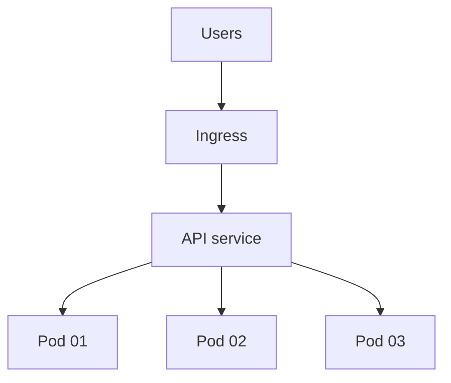
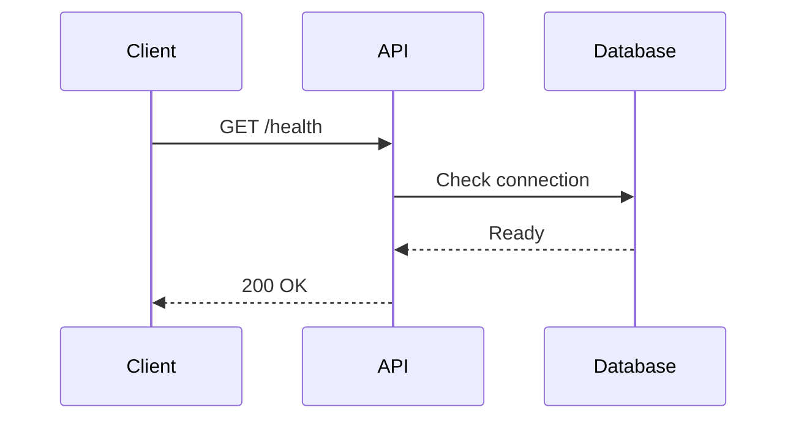

# Kubernetes deployment guide

A practical runbook for shipping services with confidence. From configuration to a healthy production deployment.

## Before you begin

- [x] Access to your Kubernetes cluster
- [x] `kubectl` configured for your environment
- [ ] Container image pushed to the registry

> [!NOTE]
> Verify your current context before applying changes: `kubectl config current-context`.

## Define your deployment

Keep the manifest in version control alongside your service. Adjust the image and probes for your application.

```yaml
apiVersion: apps/v1
kind: Deployment
metadata:
  name: api-service
spec:
  replicas: 3
  selector:
    matchLabels:
      app: api-service
  template:
    metadata:
      labels:
        app: api-service
    spec:
      containers:
        - name: api
          image: your-registry/api:1.2.0
          ports:
            - containerPort: 8080
```

## Verify the rollout

```bash
# Apply the manifest and wait for the rollout
kubectl apply -f deployment.yaml
kubectl rollout status deployment/api-service
kubectl get pods -l app=api-service
```

| Check | Expected result | Status |
| --- | --- | --- |
| Replicas | 3 / 3 ready | Healthy |
| Health endpoint | `200 OK` | Passing |
| Rollout | Successfully rolled out | Complete |

> [!WARNING]
> This is an illustrative manifest. Add resource requests, limits, readiness probes and the security configuration required by your environment.

## Deployment architecture

Diagrams live directly in your Markdown as `mermaid` code blocks.



### Request lifecycle



## Reliability calculations

Inline math fits right into a sentence: availability is $A = 1 - E/R$, where $E$ is failed requests and $R$ is total requests.[^availability]

$$
A = \left(1 - \frac{E}{R}\right) \times 100\%
$$

Display equations also work for mean latency:

$$
L = \frac{1}{n}\sum_{i=1}^{n}t_i
$$

## Operational notes

1. Deploy to a staging environment first.
2. Validate the release:
   - Check metrics and logs.
   - Compare latency with your baseline.
3. Record the release in your change log.

<details>
<summary>Rollback procedure</summary>

```bash
kubectl rollout undo deployment/api-service
kubectl rollout status deployment/api-service
```

</details>

Attach screenshots with **Add local images**, then reference them with ``.

For more information, see the [Kubernetes documentation](https://kubernetes.io/docs/concepts/workloads/controllers/deployment/).

[^availability]: This example measures availability by request success rate. Choose the indicator that matches your service's SLO.
